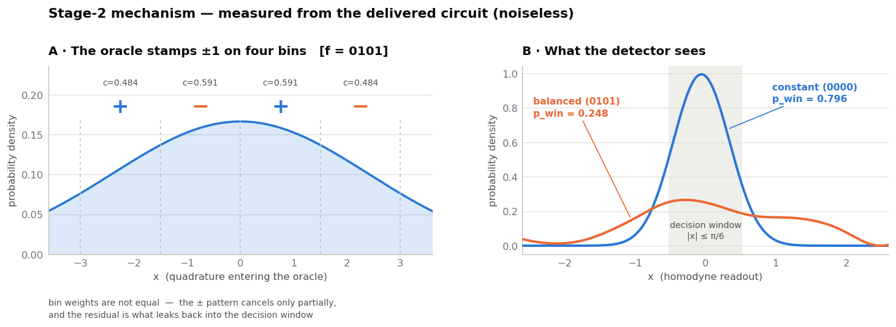

<div dir="rtl">

# بهینه‌سازی الگوریتم Deutsch–Jozsa پیوسته‌متغیر · پلی‌هک ۲۰۲۶

[English](README.md) · **فارسی**

راه‌حل مرحلهٔ ۲ تیم **`polyhaq`** برای چالش `PQO-2026-CV01` در رویداد **پلی‌هک**
(هکاتون کوانتومی دانشگاه صنعتی امیرکبیر).

هدف: طراحی بلوک‌های آماده‌سازی حالت (`prep`) و بازخوانی (`readout`) یک مدار
Deutsch–Jozsa پیوسته‌متغیرِ نویزدار و دارای اتلاف (شبیه‌سازی‌شده با
[Strawberry Fields](https://strawberryfields.ai/))، به‌طوری‌که در **بدترین حالت** اوراکل‌های
`constant` و `balanced` را با بیشترین اطمینان از هم تشخیص دهد و هر چهار قید منابع را رعایت کند.

## نتایج

ارزیاب رسمی، ۲۴ سید عمومی:

| کمیت | مقدار | حد / مرجع |
|---|---|---|
| `S_worst` | **0.87732** | نقطهٔ شروع رسمی: 0.83138 |
| DJ score | **87.73 / 100** | |
| امتیاز مرحله ۲ | **40.17 / 60** | |
| کمینهٔ `raw_trace` | 0.98633 | ≥ 0.98 |
| بیشینهٔ `edge3` | 0.00129 | ≤ 0.02 |
| بیشینهٔ `n̄` | 6.398 | ≤ 8.0 |
| `Σ\|r\|` | 0.39361 | ≤ 0.40 |

مدار تحویلی ([`results/submission.json`](results/submission.json)) فقط از گیت‌های
`S`، `P`، `R` و `X` استفاده می‌کند و گیت `V` ندارد.



## روش، به‌طور خلاصه

۱. **کل مسئله به یک انتگرال تقلیل می‌یابد:** برای اوراکل `constant` فاز سراسری است، دو
   تبدیل فوریه یکدیگر را خنثی می‌کنند و آشکارساز همان حالت `prep` را می‌بیند. پس باید
   توزیع مکانیِ `prep` را داخل پنجرهٔ `|x| ≤ π/6` جمع کرد.

۲. **موتور سریع:** بازنویسی انتشار حالت در numpy، ارزیابی ۲۴ سید را از حدود ۷ دقیقه
   به حدود ۶ ثانیه رساند.

۳. **باگ مهم:** ساختن گیت‌ها با `expm` ماتریس دقیقاً یکانی می‌دهد و اتلافِ رد را پنهان
   می‌کند، یعنی همان قید `raw_trace ≥ 0.98`. با استفاده از ماتریس‌های خودِ Strawberry Fields،
   دو موتور تا `1e-15` توافق دارند.

۴. **تابع هدف minimax** با `softmin` و Nelder–Mead تطبیقی روی ۶ سید توسعه.

۵. **حذف `V`** امتیاز را بالا برد، چون نویز کالیبراسیون در `θ = 0` صفر است.

۶. **انتخاب کاندیدا بر اساس امتیاز مورد انتظار**، نه بیشترین `S_worst` خام، چون
   نقض قید روی ۲۰۰ سید خصوصی یعنی امتیاز صفر.

گزارش کامل روش و نتایج در بخش آخر نوت‌بوک آمده است.

## اجرا

ماژول ارزیاب رسمی `cv_dj_stage2_public_evaluator.py` در این مخزن **نیست**. آن را در
پوشهٔ `notebooks/` قرار دهید، سپس:

</div>

```bash
pip install -r requirements.txt
```

```bash
cd notebooks && jupyter lab CV_DJ_Stage2_Polyhaq.ipynb
```

<div dir="rtl">

## مجوز

[MIT](LICENSE)

</div>
