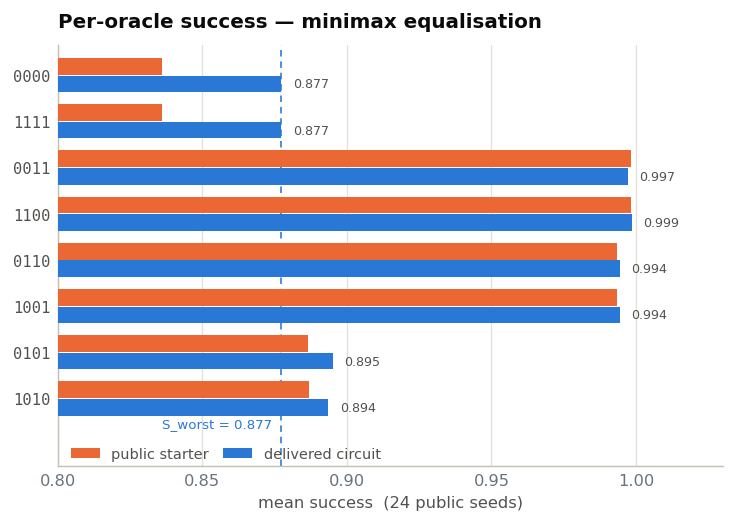
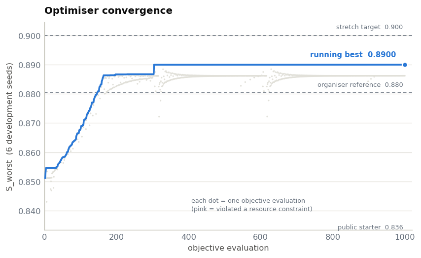

# Continuous-Variable Deutsch–Jozsa Optimisation · PolyHaQ 2026

**English** · [فارسی](README.fa.md)

Team **`polyhaq`**'s Stage-2 solution to challenge `PQO-2026-CV01` at **PolyHaQ**, the
quantum hackathon at Amirkabir University of Technology (Tehran Polytechnic).

The task: design the state-preparation and readout blocks of a noisy, lossy
**continuous-variable Deutsch–Jozsa** circuit (simulated in
[Strawberry Fields](https://strawberryfields.ai/)) so that it tells *constant* from
*balanced* oracles as reliably as possible in the **worst case**, while staying inside
four hard resource constraints.

## Results

Official evaluator, 24 public seeds:

| Metric | Value | Limit / reference |
|---|---|---|
| `S_worst` (worst-oracle success) | **0.87732** | public starter: 0.83138 |
| DJ score | **87.73 / 100** | |
| Stage-2 points | **40.17 / 60** | |
| min `raw_trace` | 0.98633 | ≥ 0.98 |
| max `edge3` | 0.00129 | ≤ 0.02 |
| max `n̄` | 6.398 | ≤ 8.0 |
| `Σ\|r\|` (squeezing) | 0.39361 | ≤ 0.40 |

The delivered circuit ([`results/submission.json`](results/submission.json)) uses only
the `S`, `P`, `R` and `X` gates. It uses no cubic-phase `V` gate; dropping `V` raised the
score (see below).


## Approach

1. **The whole problem reduces to one integral.** For a constant oracle the phase
   `e^{iπf}` is global, so the forward and inverse Fourier rotations cancel and the
   detector sees the prepared state itself. Its success is just the probability mass of
   `|ψ_prep(x)|²` inside the decision window `|x| ≤ π/6`. The optimisation squeezes the
   prep state into that window without letting the hardest balanced oracles
   (`0101`/`1010`) leak back into it.
2. **A fast engine ~70× faster than the reference.** State propagation is rewritten in
   numpy (loss channel as a Kraus sum; the window integral folded into two fixed 48×48
   operators; prep and readout built once per seed). A 24-seed evaluation drops from
   ~7 min to ~6 s. Constants, noise draws and scoring are imported from the official module.
3. **A bug worth reporting.** The first engine built gates as `expm` of a truncated
   generator. That matrix is exactly unitary, so `raw_trace` was always 1.
   Strawberry Fields instead uses the truncated matrix elements of the infinite-dimensional
   gate, which are *not* unitary, and that lost trace is exactly the `raw_trace ≥ 0.98`
   constraint. A candidate with `S_worst = 0.8978` passed our checks but the official
   evaluator rejected it. After switching to SF's own Fock-backend gate matrices, the
   two engines agree to `1e-15` on trace and `2.5e-4` on success.
4. **Minimax objective.** `−softmin_β(success) + penalties`, annealed
   `β = 30 → min → 80 → min → min` with restarted adaptive Nelder–Mead on 6 development
   seeds. The squeezing budget is enforced by projection rather than a penalty, and the
   penalties aim *inside* each limit.
5. **Dropping `V`.** The optimiser's cubic-phase values were tiny (≤ 0.014) but still
   carried gate-calibration noise, which is exactly zero at `θ = 0`. Zeroing them
   **raised** `S_worst` by 0.0009 and avoided spending a Stage-1 rescue token.
6. **A risk-aware choice of candidate.** Ranking uses 200 private seeds and any
   constraint violation scores zero. We modelled the per-oracle `raw_trace` margin
   (5.33σ, P(invalid) ≈ 1e-5) and picked the candidate with the highest **expected**
   score, not the highest raw `S_worst`:

   | Candidate | `S_worst` | Margin | P(invalid) | E[points] |
   |---|---|---|---|---|
   | aggressive | 0.88103 | 3.31σ | 8.8 % | 39.58 |
   | **delivered** | **0.87732** | **5.33σ** | **1e-5** | **40.17** |
   | conservative | 0.87024 | 8.98σ | ≈ 0 | 33.97 |

| Per-oracle success | Optimiser convergence |
|---|---|
|  |  |

The full method report (in Persian) is the last section of the notebook.

## Repository layout

```
.
├── notebooks/
│   └── CV_DJ_Stage2_Polyhaq.ipynb   # the complete Stage-2 deliverable (code + report)
├── results/
│   └── submission.json              # delivered 15-slot circuit
├── figures/                         # plots from the recorded run
├── requirements.txt
└── LICENSE
```

## Reproducing

The notebook needs the organisers' evaluator module `cv_dj_stage2_public_evaluator.py`,
which is **not** included in this repository. Place it in `notebooks/`, then:

```bash
python -m venv .venv && source .venv/bin/activate
```

```bash
pip install -r requirements.txt
```

```bash
cd notebooks && jupyter lab CV_DJ_Stage2_Polyhaq.ipynb
```

Three switches in the first code cell control how much work it does:

| Flag | Default | Cost |
|---|---|---|
| `RUN_OPTIMISATION` | `False` | hours; otherwise the delivered parameters are loaded |
| `RUN_OFFICIAL` | `True` | ~5–8 min (official evaluator, 24 seeds) |
| `RUN_ABLATION` | `True` | ~30 s (with vs. without `V`) |

The convergence history of the original run is embedded in the notebook, so no extra
data files are needed.

## License

[MIT](LICENSE)
